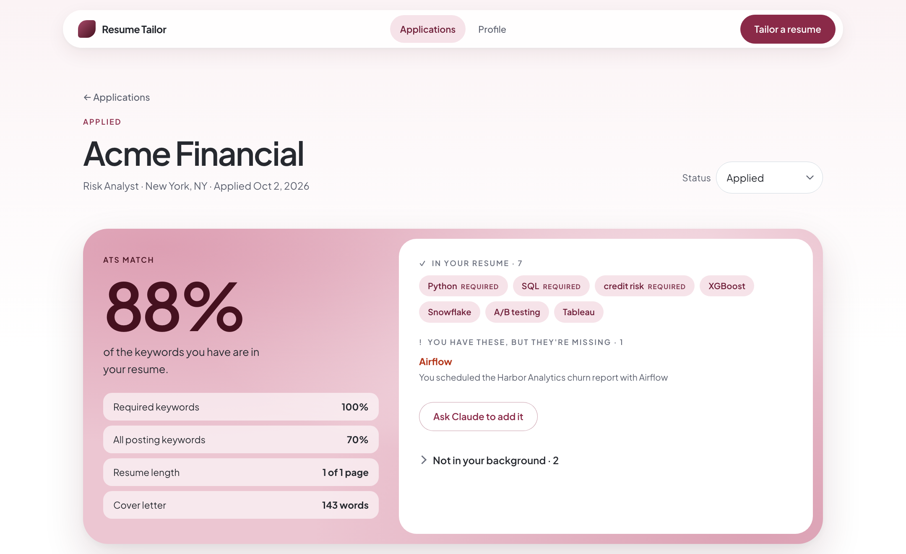
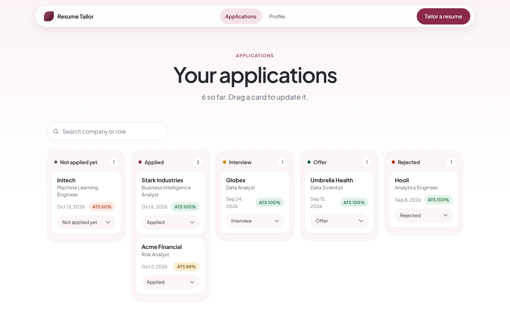
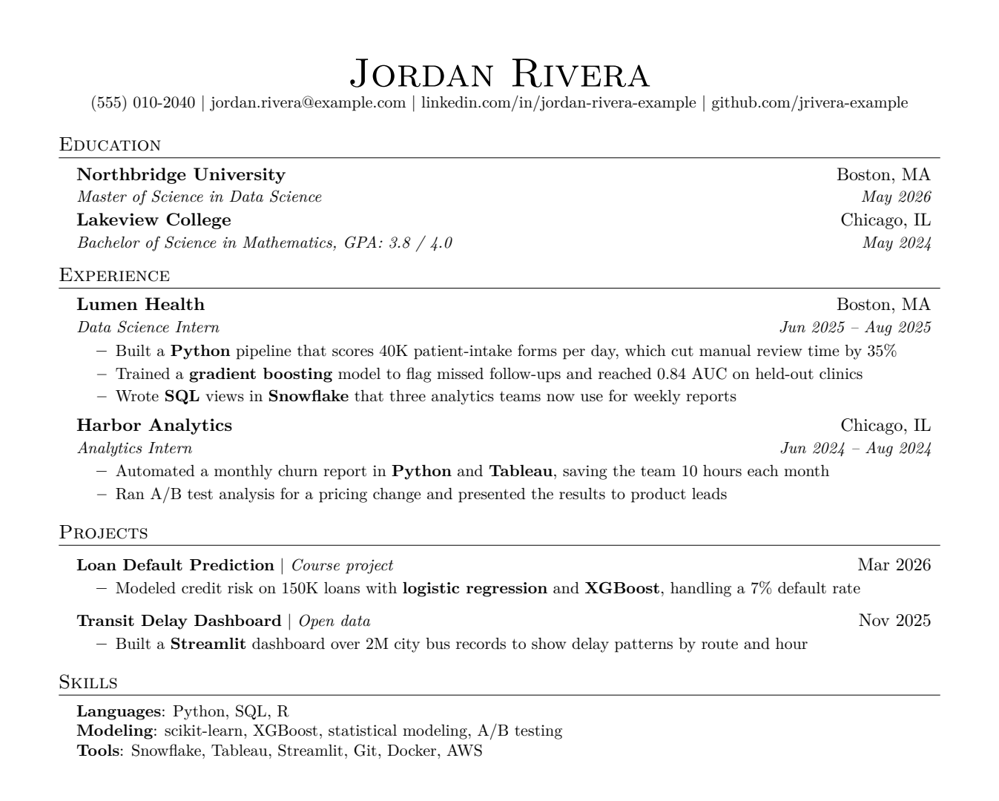

# Resume Tailor

Resume Tailor is a local web app. It uses Claude to tailor your LaTeX resume and cover letter to one job posting. It checks the result with an ATS keyword scan. It also keeps a record of each job that you apply to.



## What it does

- You paste a job posting. Claude writes a tailored resume and cover letter in your own LaTeX templates.
- The app compiles both documents to PDF. If the LaTeX does not compile, Claude fixes the error.
- The app reads the text in the PDF, the same way an applicant tracking system (ATS) reads it. Then it shows which keywords from the posting are in the resume.
- If a keyword that you have is missing, or if the resume is too long, the app sends the problem back to Claude.
- You can ask for changes in plain English. You can also edit the LaTeX directly.
- A board shows each application by status: not applied yet, applied, interview, offer, or rejected.
- Each application keeps the original job posting, your notes, and the exact PDFs that you sent.



## How it works

1. **Profile.** You give the app four items one time:
   - An "info dump" with all of your experience.
   - A LaTeX resume template.
   - A LaTeX cover letter template.
   - A reference cover letter (optional). New letters use its voice and structure.
2. **Tailor.** Claude reads the posting. It finds the ATS keywords and marks the keywords that your background supports. Then it selects your most relevant experience and writes it into your template. It uses the macros of your template, so the design does not change.
3. **Compile.** Tectonic (a XeTeX engine) compiles the LaTeX to PDF.
4. **Check.** The app extracts the text from the PDF and searches it for each keyword. It also counts the resume pages and the words in the cover letter.
5. **Polish.** If a check fails, Claude gets a specific instruction. An example is "cut the letter to 220 words". Then the app repeats steps 3 and 4. It does this two times at most.



## Design decisions

- **Honesty.** Claude uses only facts from your own materials. It does not add skills, employers, dates, or metrics. A keyword counts as "in your background" only if you did that exact work. The app shows unsupported keywords as gaps and does not add them.
- **Readable bullets first.** A keyword goes into a bullet only if it describes that work correctly. Otherwise it goes into the Skills section. Claude rereads each bullet and rewrites the bullets that sound forced.
- **The ATS check uses the PDF.** An ATS reads the PDF, not the LaTeX source. Thus the app checks the extracted PDF text. This finds problems that the source does not show, for example a bare `%` that deletes the rest of a line.
- **The app enforces the rules in code.** Instructions to a model are not guarantees. Thus the app does these steps itself:
  - It escapes a `%` that follows a number.
  - It changes only the document that you select in a revision.
  - It measures the page count and the word count.
- **No changes to Education.** Claude copies the Education section from your template exactly. It does not rename or abbreviate a degree.
- **Cost control.** The default model is Claude Sonnet 5 at medium effort. LaTeX fixes use low effort. Prompt caching reuses your profile across requests.
- **Accessibility.** The UI follows WCAG AA. All text has a contrast ratio of 4.5:1 or more. You can use the keyboard for all controls, and all controls have labels for screen readers. Delete and status changes have an Undo option.

## Tech stack

| Part | Technology |
|---|---|
| Model | Claude API (Anthropic Python SDK), structured outputs, streaming, prompt caching |
| Backend | Python, FastAPI, SQLite |
| PDF | Tectonic (LaTeX to PDF), pypdf (text extraction) |
| Frontend | HTML, CSS, and JavaScript, with no framework |
| Tooling | uv (dependencies and lock file) |

## Set up and run

You need a Mac with [Homebrew](https://brew.sh) and an [Anthropic API key](https://console.anthropic.com).

1. Install the tools:
   ```
   brew install uv tectonic
   ```
2. Copy `.env.example` to `.env`.
3. Open `.env` and put your API key after `ANTHROPIC_API_KEY=`.
4. Start the app:
   ```
   uv run main.py
   ```
5. Go to http://localhost:8000. The app opens this page automatically.
6. On the **Profile** page, add your info dump, your templates, and your reference letter. Then click **Save**.
7. Click **Tailor a resume** and paste a job posting.

The first run installs the Python packages from `uv.lock`. The first compile also downloads the LaTeX packages. Thus the first run takes more time.

## Configuration

Set these values in `.env`:

| Variable | Default | Purpose |
|---|---|---|
| `ANTHROPIC_API_KEY` | none | Your API key. This value is necessary. |
| `MODEL` | `claude-sonnet-5` | The Claude model. Use `claude-opus-5` for the best quality at a higher cost. |
| `EFFORT` | `medium` | How much the model thinks: `low`, `medium`, `high`, `xhigh`, or `max`. |
| `RESUME_TAILOR_DATA` | `data/` | A different data folder, for example for tests. |

## Cost

One application costs approximately $0.10 to $0.35 with the default model. A revision costs approximately $0.05 to $0.10. The cost changes with the length of your info dump and the number of polish passes.

## Your data

All data stays on your computer, in the `data/` folder. This folder contains the database, your profile, and the PDFs. Git ignores this folder and the `.env` file. The app sends your materials to the Claude API only to write the documents. Make a backup copy of `data/` from time to time.

## Project structure

```
main.py              Starts the server and opens the browser
app/
  main.py            API routes
  pipeline.py        Background jobs: tailor, compile, check, polish
  llm.py             Claude prompts and API calls
  latex.py           LaTeX compile and PDF text extraction
  ats.py             Keyword search in the PDF text
  profile.py         Your templates and info dump
  db.py              SQLite storage
  static/            The web interface
docs/screenshots/    Images for this README (fictional sample data)
```

## License

This project uses the MIT License. See [LICENSE](LICENSE).

Built by Angel M. Ortega. [GitHub](https://github.com/angelmortega) · [LinkedIn](https://linkedin.com/in/angel-m-ortega)
